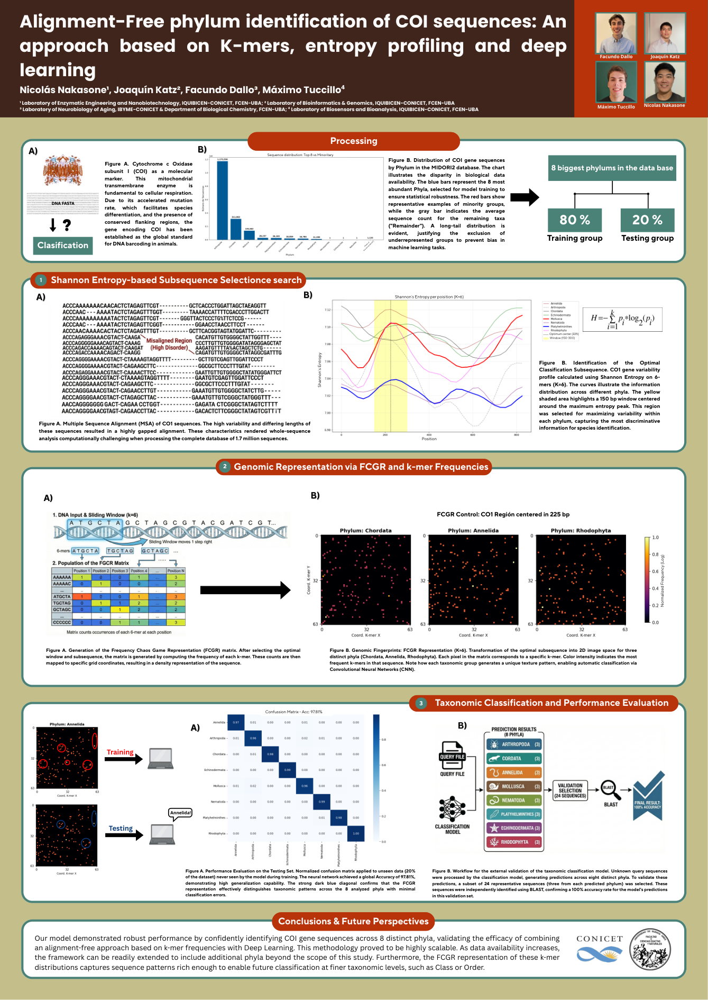
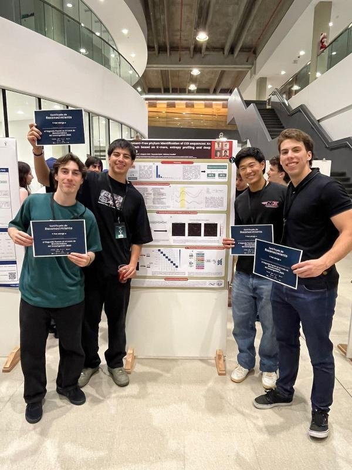
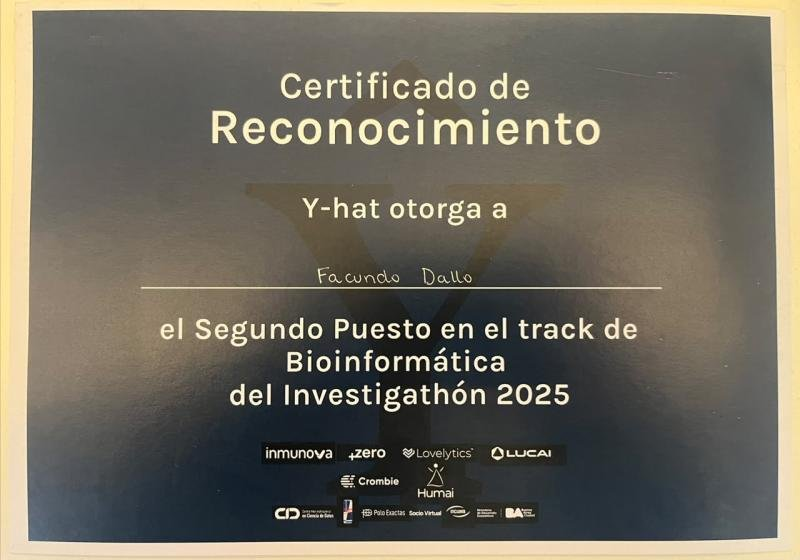
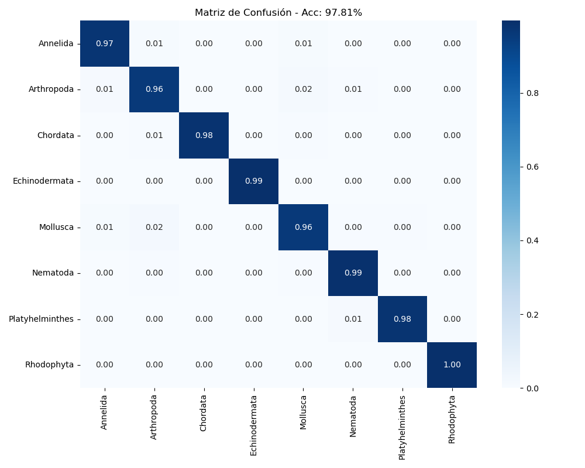
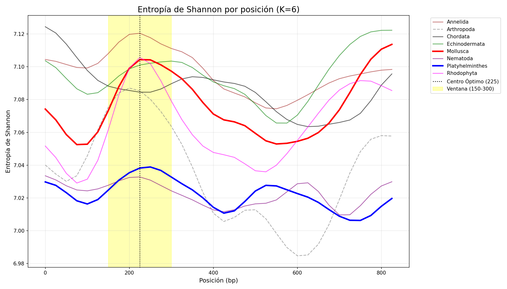
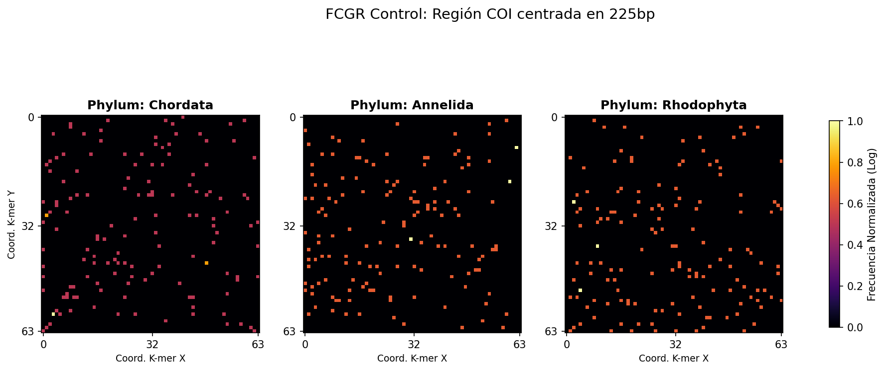
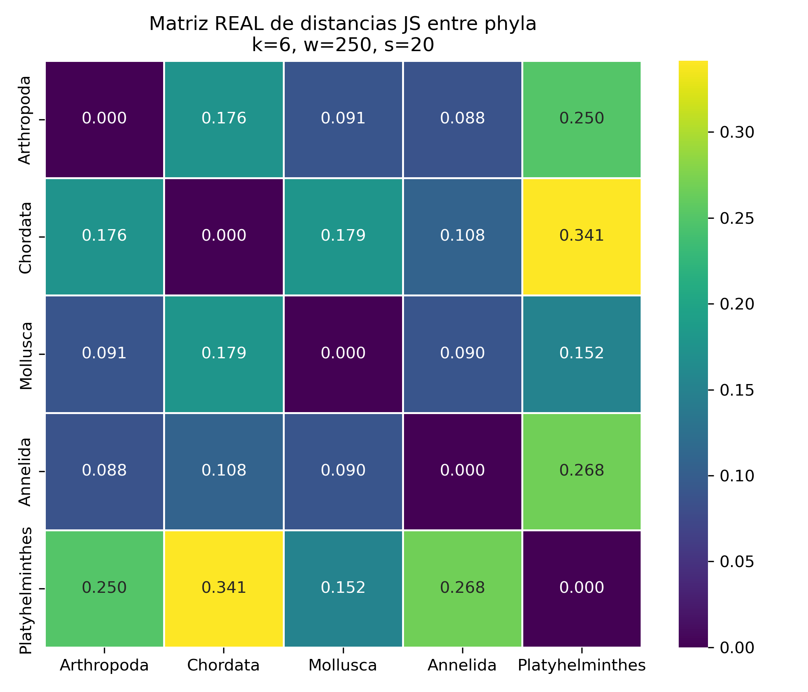
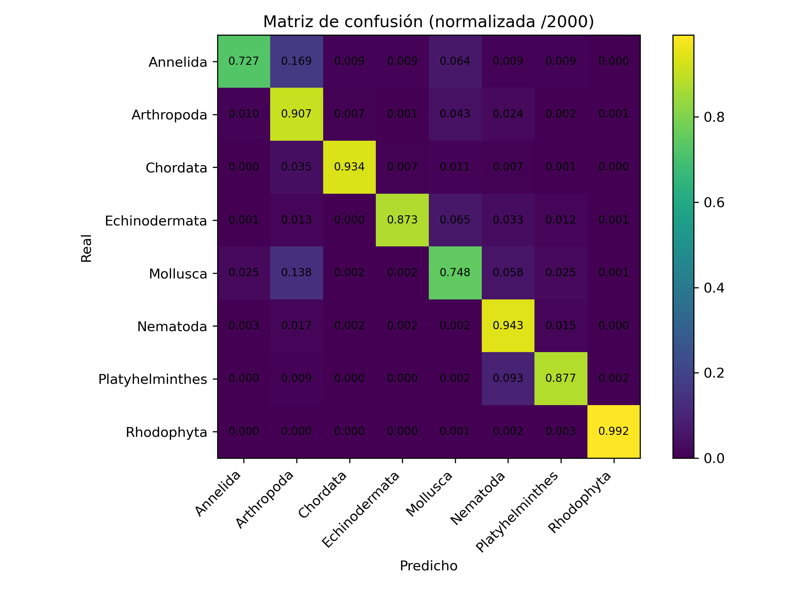
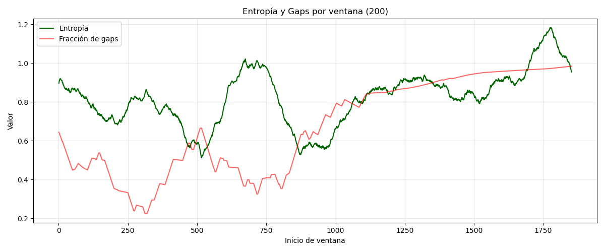

# yhat — Alignment-free phylum identification of COI sequences

**An approach based on k-mers, entropy profiling and deep learning**

[Nicolás Nakasone](https://github.com/niconaka23), [Joaquín Katz](https://github.com/JHK212), [Facundo Dallo](https://github.com/FacundoDallo), [Máximo Tuccillo](https://github.com/maxituccillo) — IQUIBICEN / IBYME-CONICET, FCEN-UBA

**Second place — Bioinformatics track, Investigathon 2025** (organized by Y-hat)

Given a fragment of the mitochondrial **COI (cytochrome c oxidase subunit I)** gene, predict its
**phylum** without aligning it against a reference database.

📄 **[Poster (PDF)](poster/poster.pdf)**

[](poster/poster.pdf)

<p>
  
  
  
</p>

Two approaches were evaluated on the same dataset (8 phyla, 10,000 sequences per phylum, 80/20 split):

| Approach | Representation | Classifier | Test accuracy (8 phyla) |
|---|---|---|---|
| **CNN + FCGR** (final model, poster) | 64×64 FCGR image (k=6) of a 150 bp window in the most informative region of COI | Convolutional neural network (3 conv blocks + dense) | **97.8%** |
| k-mers + Jensen-Shannon | Sliding-window 6-mer frequency profile (w=250, s=20) | Jensen-Shannon divergence to the mean profile of each phylum | 88.1% |



**External validation:** on an unlabeled query file, 24 predictions (3 per predicted phylum) were
independently checked with BLAST (NCBI): 24/24 matched.

---

## Dataset

- Source: **MIDORI2** — `MIDORI2_UNIQ_NUC_GB268_CO1` (`.fasta` + `.taxon`), <https://www.reference-midori.info/>
- Phyla with ≥ 10,000 sequences are kept: *Annelida, Arthropoda, Chordata, Echinodermata, Mollusca,
  Nematoda, Platyhelminthes, Rhodophyta*.
- Balanced sampling of 10,000 sequences per phylum (seed 42), 80% train / 20% test.

The data is **not included** in the repository because of its size (the raw FASTA is ~1.2 GB).
See [`data/README.md`](data/README.md).

---

## Repository layout

```
yhat/
├── cnn_fcgr/          # Final pipeline: preprocessing → ROI → FCGR → CNN → prediction
├── kmer_js/           # Alignment-free k-mer profiles + Jensen-Shannon divergence
│   ├── scripts/       #   profile building, grid search, classification, plots
│   ├── profiles/      #   trained profiles (k=6, w=250, s=20) as JSON
│   └── results/       #   grid search (k, w, s) and confusion matrix
├── subsequence/       # Search for the variable region of COI (MAFFT + Shannon entropy)
├── figures/           # Result figures (event/: photos from the Investigathon)
├── poster/            # Presented poster (PDF + preview)
├── data/              # (empty) instructions to download the data
└── requirements.txt
```

---

## 1. CNN + FCGR pipeline (`cnn_fcgr/`)

| Step | Script | What it does | Output |
|---|---|---|---|
| 0 | `preprocessing.py` | Cleans MIDORI2 taxonomy, keeps phyla with ≥ 10k sequences, balances classes and splits train/test | `dataset_10k_{train,test}.{fasta,taxon}` |
| 1 | `step1_entropy_roi.py` | Shannon entropy (k=6) along COI to locate the most informative region | `subseq_co1.png` → centered at **225 bp**, 150 bp window |
| 2 | `step2_fcgr_dataset.py` | Crops the region of interest (±10 bp shifts as data augmentation) and converts it into a 64×64 **FCGR** (*Frequency Chaos Game Representation*) image | `X_{train,test}.npy`, `y_{train,test}.npy` |
| 3 | `step3_train_cnn.py` | Trains the CNN (Keras) with early stopping and evaluates it on the test set | `classifier.keras`, `classes.npy`, `confusion_matrix.png` |
| 4 | `predict.py` | Inference on a new FASTA: scans 150 bp windows (stride 50) and keeps the most confident one; confidence threshold 0.75 | `submission_final_smart.csv` |
| 5 | `verify_blast.py` | Checks a sample of predictions against BLAST (NCBI) | console output |

```bash
cd cnn_fcgr
python preprocessing.py        # needs MIDORI2_UNIQ_NUC_GB268_CO1.{fasta,taxon} in this folder
python step1_entropy_roi.py
python step2_fcgr_dataset.py
python step3_train_cnn.py
python predict.py              # needs query.fasta
```

<p>
  
  
</p>

---

## 2. k-mers + Jensen-Shannon (`kmer_js/`)

**Alignment-free** approach: each phylum is represented by the average k-mer frequency profile
computed over sliding windows; a new sequence is assigned to the phylum with the lowest
Jensen-Shannon divergence.

- **Grid search** over k ∈ {4, 5, 6}, w ∈ {150, 200, 250}, s ∈ {10, 20}
  (`grid_search_sliding.py`, results in `results/grid_eval.tsv`). **k** is the dominant parameter:
  with k=6 the minimum separation between phyla (min JS ≈ 0.088) is larger than with k=5 (≈ 0.053) or k=4.
- Selected setup: **k=6, w=250, s=20**.
- The JS distance topology (heatmap + Ward dendrogram) is consistent with phylogeny:
  Mollusca–Annelida–Arthropoda close together (protostomes), Chordata separated, Platyhelminthes the
  most distant.

Details in [`kmer_js/README.md`](kmer_js/README.md), [`kmer_js/METHODS.md`](kmer_js/METHODS.md) and
[`kmer_js/SCRIPTS.md`](kmer_js/SCRIPTS.md).

<p>
  
  
</p>

---

## 3. Subsequence search (`subsequence/`)

Exploratory analysis to locate the most variable region of COI:

- `curate_dataset.py`, `split_by_phylum.py`: length filtering and per-phylum split.
- `find_variable_region.py`: sliding-window search for the most variable region.
- `phylum_analysis_pipeline.py`: **MAFFT** alignment, per-column Shannon entropy and selection of the
  optimal subsequence (requires Linux/WSL with `mafft` installed).
- `entropy/`: per-window conservation statistics over the alignment.



---

## Requirements

```bash
pip install -r requirements.txt
```

`subsequence/phylum_analysis_pipeline.py` also requires [MAFFT](https://mafft.cbrc.jp/alignment/software/).
